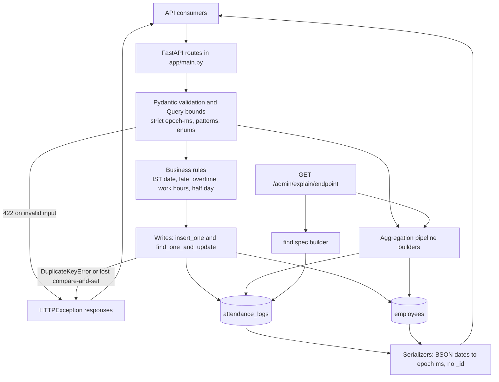
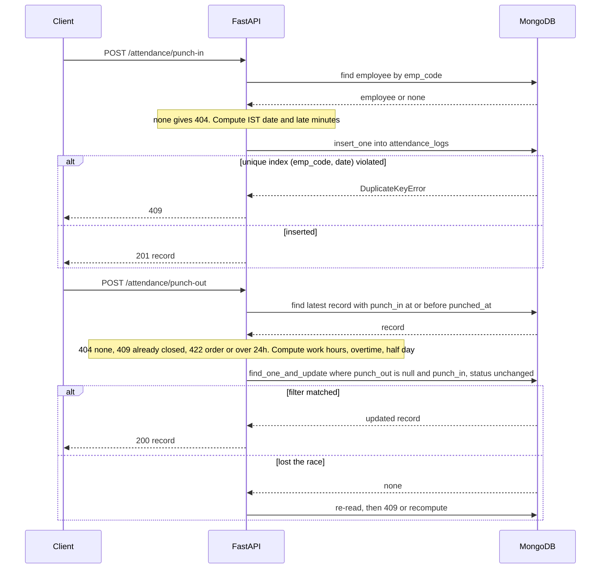
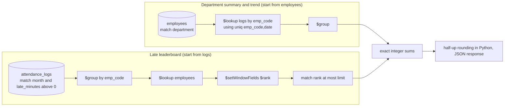

# Employee Attendance & Analytics API

[](https://www.python.org/)
[](https://fastapi.tiangolo.com/)
[](https://www.mongodb.com/)
[](https://pymongo.readthedocs.io/)
[](#testing-and-reproducibility)

A small HR back end: employees punch in and out under explicit business rules, HR can correct a day with a permanent audit trail, and four analytics endpoints answer attendance questions with **MongoDB aggregation pipelines** instead of Python loops. Written for the HROne Software Engineer Trainee assignment; the focus is correctness under concurrency and honest verification, not feature count.

* **Consumers:** an HR/admin front end, a time clock or mobile app (punch endpoints), and reporting tools (analytics).
* **Everything lives in** [`app/main.py`](app/main.py) (the assignment requires a single application file). Tests are in [`tests/`](tests/).

## Table of contents
1. [What is technically interesting](#what-is-technically-interesting)
2. [Architecture](#architecture)
3. [Data model and indexes](#data-model-and-indexes)
4. [Attendance lifecycle and concurrency](#attendance-lifecycle-and-concurrency)
5. [Business rules and edge cases](#business-rules-and-edge-cases)
6. [Analytics](#analytics)
7. [API reference](#api-reference)
8. [Quick start](#quick-start)
9. [Testing and reproducibility](#testing-and-reproducibility)
10. [Breaking points found and how they were fixed](#breaking-points-found-and-how-they-were-fixed)
11. [Engineering decisions and trade-offs](#engineering-decisions-and-trade-offs)
12. [Performance evidence](#performance-evidence)
13. [Troubleshooting](#troubleshooting)
14. [Suggested reviewer walkthrough](#suggested-reviewer-walkthrough)
15. [Limitations and future work](#limitations-and-future-work)

## What is technically interesting
* **Races are settled by the database, not by Python.** One record per employee per day is a unique index; punch-out and corrections are compare-and-set updates.
* **Append-only audit history** with compare-and-set on the history length, so concurrent corrections cannot silently overwrite each other.
* **Exact rounding.** MongoDB's `$round` rounds half to even, but the rules require half-up. Pipelines return exact integer sums and a small integer helper does the final rounding, so there is no float error.
* **Gap-free trend.** The department trend returns one row for every calendar day using `$densify`, then `$setWindowFields` for the running headcount and the 7-row moving average.
* **Explain endpoint built from the same builders** as the real endpoints, so it explains the query that actually runs.

## Architecture

**Request lifecycle.** A request is validated (bad input never reaches MongoDB), the employee is loaded, the pure rule functions compute derived values, and one atomic MongoDB operation persists the result. Expected conflicts (`DuplicateKeyError`, a compare-and-set that matched nothing) become 409; unexpected database errors become 503 through a single exception handler. Responses go through serializers that convert BSON dates to epoch milliseconds and never expose `_id`. The app is a single process with synchronous endpoints, so FastAPI runs them in its thread pool.

## Data model and indexes
Collections: `employees` and `attendance_logs` (database name from `MONGO_DB`). Instants are BSON dates in MongoDB and epoch milliseconds in the API; the client is created with `tz_aware=True` so every datetime read is timezone-aware UTC.

**`employees`**: `emp_code`, `name`, `email`, `department`, `shift_start` (`HH:MM`, IST), `shift_end`, `joined_on` (`YYYY-MM-DD`), `created_at`.

**`attendance_logs`**: `emp_code`, `date` (IST attendance date, `YYYY-MM-DD`), `status` (`PRESENT`, `WFH`, `ON_DUTY`, `ABSENT`, `LEAVE`), `punch_in`, `punch_out`, `work_hours`, `late_minutes`, `overtime_minutes`, `half_day`, `history[]` entries `{at, by, reason, changes}`.

| Index | Enforces / supports | Defined in |
|---|---|---|
| `employees (emp_code)` unique | Business-key uniqueness; every lookup by code (punch, leaderboard `$lookup`) | `ensure_indexes()` |
| `employees (department, emp_code)` | Employee list by department sorted by code; first stage of the department summary and trend | `ensure_indexes()` |
| `attendance_logs (emp_code, date)` unique | **One record per employee per day** (punch-in race); per-employee date ranges (punch-out lookup, monthly summary, `$lookup` in summary and trend) | `ensure_indexes()` |
| `attendance_logs (date desc, emp_code)` | `GET /attendance` sort order and date range; the month scan at the start of the leaderboard | `ensure_indexes()` |
| `attendance_logs (status, date desc, emp_code)` | Status filter with the same sort, no in-memory sort | `ensure_indexes()` |

**Database-enforced:** the two unique indexes. **Application-level only:** field patterns, status rules, shift/date rules, the append-only history convention. Index creation runs at startup and is idempotent (same name and key spec is a no-op). Each extra index costs write time and storage, which is why there are only five.

## Attendance lifecycle and concurrency

| Scenario | Mechanism | Outcome |
|---|---|---|
| N simultaneous identical punch-ins | Unique `(emp_code, date)` index plus a single `insert_one` | one 201, others 409 |
| N simultaneous punch-outs | `find_one_and_update` filtered on `punch_out: null` and the `punch_in`/`status` that the calculation used | one 200, others 409 |
| Concurrent corrections (`PATCH`) | Filter pins status, punch times and **history length**; `$set` plus `$push` in one document update; on mismatch re-read, recompute, retry (5 attempts) then 409 | no history entry lost or rewritten |
| Concurrent employee creation | Unique `emp_code` index | one 201, others 409 |

There is **no multi-document transaction and no distributed lock**: each operation touches one document, and MongoDB guarantees single-document atomicity. Limitation: a correction that loses 5 consecutive races returns 409 and the client retries.

## Business rules and edge cases
Rule numbers refer to the assignment contract. The tests named below compute expected values independently of the implementation.

| Rule | Behaviour | Where / test |
|---|---|---|
| Instants (R1) | Epoch milliseconds, strict integers in the range 1e11..4.1e12; seconds-looking values, floats, strings and booleans are 422. Truncated to whole seconds; the truncated value is stored. | `EpochMs`, `test_punched_at_rejects_...` |
| Attendance date (R1) | IST calendar date of `punch_in`; overnight shift (`shift_end <= shift_start`): a punch before `shift_end` belongs to the previous day | `attendance_date`, `test_overnight_*` |
| Late (R2) | Late only if **strictly more than 10:00** after `shift_start`; then whole minutes since `shift_start`. 09:40:00 gives 0, 09:40:01 gives 10, 10:15:59 gives 45 (shift 09:30) | `compute_late_minutes`, `test_late_minutes_contract_examples` |
| Overtime (R3) | Whole minutes after `shift_end`, only if at least 30; the end of an overnight shift is on the next day | `compute_overtime` |
| Work hours (R4) | seconds / 3600, **half-up** to 2 decimals (18 s gives 0.01, not 0.0) | `round_half_up`, `test_work_hours_half_up_not_bankers` |
| Half day (R5) | `work_hours` (the rounded value) below 4.50; 16182 s rounds to 4.50 so it is **not** a half day | `test_half_day_uses_rounded_value` |
| Client-sent derived fields | Ignored (`extra="ignore"`); the server always computes them | `test_client_sent_derived_fields_are_ignored` |
| Duplicate punch-in / punch-out | 409 | `test_duplicate_punch_in_is_409`, `test_punch_out_errors` |
| Unknown employee | 404 (never 500) | `get_employee_or_404` |
| Punch-out window | 422 if not after `punch_in` or more than 24 h later (exactly 24 h is allowed) | `test_punch_out_errors` |
| Corrections | Omitted fields unchanged; derived fields recomputed; one history entry per success containing only fields that actually changed (nested punch times in epoch ms); `ABSENT`/`LEAVE` clear the punch times and reject supplied ones (422); a presence status needs a `punch_in`; `punch_in` must stay on the record's date; a request that changes nothing is 422 | `regularize_attendance`, `test_regularize_*` |
| Legacy documents | Missing `history`, `half_day`, `late_minutes`, `overtime_minutes` are read as `[]`, `false`, `0`, `0` | `serialize_attendance`, `test_legacy_*` |
| Invalid input | FastAPI's default 422 body; expected conflicts return `{"detail": "<message>"}` | see [API reference](#api-reference) |

## Analytics
All four endpoints aggregate inside MongoDB. Python only converts the final exact integers into rounded numbers.



| Endpoint | Measures | Strategy and edge cases |
|---|---|---|
| `GET /analytics/employees/{emp_code}/monthly` | Working days, present days (half day = 0.5), leave, late count and minutes, overtime, attendance % | `$match` on `(emp_code, date)` then one `$group`. Working days (Mon-Fri from `max(month start, joined_on)`) are counted in Python. No logs gives zeros; not yet joined gives 0 working days and `attendance_pct: null`; unknown employee 404. Weekend records count toward late/overtime but not present days. |
| `GET /analytics/departments/summary` | Per department: headcount, present days, average work hours, late/leave/on-duty counts | Starts from `employees` and `$lookup`s each person's logs (aggregated inside the lookup so documents stay small), keeping people with **no logs**. Headcount counts `joined_on` on or before the month end. Average hours is a mean over records, not over employees. Departments with headcount 0 are omitted. |
| `GET /analytics/leaderboard/late` | Employees ranked by total late minutes | Competition ranking (1, 2, 2, 4) with `$rank`; `limit` is applied **after** ranking, so ties at the cutoff are all returned and there can be more than `limit` rows; ordered by minutes descending then `emp_code`. Logs of unknown employees are ignored. With `department`, ranking happens inside it. |
| `GET /analytics/departments/{department}/trend` | One row per calendar day: headcount, present and late counts, attendance rate, 7-row moving average | Events (a join, a log, plus a seed event for the first day) are summed per day, `$densify` fills missing days, a running `$sum` gives headcount, a 7-row window averages the non-null rates. Weekends and empty days are rows; rate is `null` on non-working days or headcount 0. Unknown department 404; `to < from` or more than 92 days 422. |

**Rounding.** Rates are computed as `floor((p2*10000 + headcount) / (2*headcount))` in integer arithmetic, where `p2` is present days in half-day units. **Assumption** (the contract is silent): `moving_avg_7d` averages the already-rounded 4-decimal `attendance_rate` values shown in the response.

**Explain endpoint.** `GET /admin/explain/{endpoint}` builds the same filter/sort/pagination or pipeline as the real endpoint (shared builder functions), runs MongoDB `explain` with `executionStats`, and returns the raw output. It shows *which index a plan uses*. That is not proof of performance at scale: it says nothing about latency on a large or differently distributed dataset. The tests assert that the plans contain `IXSCAN` and not `COLLSCAN` for the specific queries they run.

## API reference
Interactive docs (when running): `http://localhost:8000/docs`.

| Method | Route | Purpose | Notable parameters | Status codes |
|---|---|---|---|---|
| GET | `/health` | Pings MongoDB | none | 200, 503 |
| POST | `/employees` | Create employee | body: `emp_code` (`EMP` + 4-6 digits), `name`, `email`, `department`, `joined_on`; optional `shift_start`/`shift_end` (default 09:30/18:30) | 201, 409 duplicate, 422 |
| GET | `/employees` | List, sorted by `emp_code` | `department`, `page` (>=1), `page_size` (1-100, default 20); `total` reflects the filter | 200, 422 |
| POST | `/attendance/punch-in` | Open today's record | body: `emp_code`, optional `punched_at` (epoch ms, default now), `status` (`PRESENT`/`WFH`/`ON_DUTY`) | 201, 404, 409, 422 |
| POST | `/attendance/punch-out` | Close the latest record at or before `punched_at` | body: `emp_code`, optional `punched_at` | 200, 404, 409, 422 |
| PATCH | `/attendance/{emp_code}/{date}` | Manual correction + audit entry | body: `reason` (5-200 chars), `regularized_by`; optional `status`, `punch_in`, `punch_out` | 200, 404, 409, 422 |
| GET | `/attendance` | List records, sorted by date desc then `emp_code` | `emp_code`, `date_from`, `date_to`, `status`, `page`, `page_size` | 200, 422 |
| GET | `/analytics/employees/{emp_code}/monthly` | Monthly summary | `month` (`YYYY-MM`) | 200, 404, 422 |
| GET | `/analytics/departments/summary` | Department summary | `month`, optional `department` | 200, 422 |
| GET | `/analytics/leaderboard/late` | Late leaderboard | `month`, `limit` (1-50, default 10), optional `department` | 200, 422 |
| GET | `/analytics/departments/{department}/trend` | Daily trend | `from`, `to` (`YYYY-MM-DD`, max 92 days) | 200, 404, 422 |
| GET | `/admin/explain/{endpoint}` | MongoDB explain | `endpoint` is one of `attendance_list`, `employee_monthly`, `department_summary`, `late_leaderboard`, `department_trend`, plus that endpoint's parameters | 200, 422 |

<details>
<summary><strong>Example requests and responses</strong> (macOS/Linux/Git Bash <code>curl</code>; PowerShell variant below)</summary>

The server must be running (see [Quick start](#quick-start)). Epoch values: `1783310280000` = 2026-07-06 09:28 IST, `1783343100000` = 18:35 IST, `1783310100000` = 09:25 IST.

```bash
curl -s -X POST localhost:8000/employees -H "Content-Type: application/json" \
  -d '{"emp_code":"EMP0001","name":"Asha Verma","email":"asha@example.com","department":"Engineering","joined_on":"2026-01-05"}'

curl -s -X POST localhost:8000/attendance/punch-in -H "Content-Type: application/json" \
  -d '{"emp_code":"EMP0001","punched_at":1783310280000}'

curl -s -X POST localhost:8000/attendance/punch-out -H "Content-Type: application/json" \
  -d '{"emp_code":"EMP0001","punched_at":1783343100000}'

curl -s -X PATCH localhost:8000/attendance/EMP0001/2026-07-06 -H "Content-Type: application/json" \
  -d '{"punch_in":1783310100000,"reason":"biometric glitch","regularized_by":"hr.admin"}'

curl -s "localhost:8000/analytics/employees/EMP0001/monthly?month=2026-07"
curl -s "localhost:8000/admin/explain/employee_monthly?emp_code=EMP0001&month=2026-07"
```

PowerShell equivalent of one call:
```powershell
Invoke-RestMethod -Method Post -Uri http://localhost:8000/attendance/punch-in -ContentType "application/json" `
  -Body '{"emp_code":"EMP0001","punched_at":1783310280000}'
```

Punch-in response (201), computed by the real code for the values above:
```json
{"emp_code":"EMP0001","date":"2026-07-06","status":"PRESENT","punch_in":1783310280000,"punch_out":null,
 "work_hours":null,"late_minutes":0,"overtime_minutes":0,"half_day":false,"history":[]}
```
Second identical punch-in (409):
```json
{"detail":"already punched in for this date"}
```
After the correction (200), `work_hours` goes from 9.12 to 9.17 and one history entry is appended containing only the fields that changed:
```json
"history":[{"at":1791702671304,"by":"hr.admin","reason":"biometric glitch",
  "changes":{"punch_in":{"from":1783310280000,"to":1783310100000},"work_hours":{"from":9.12,"to":9.17}}}]
```
Validation failure (422, FastAPI default shape), e.g. `punched_at` in seconds:
```json
{"detail":[{"type":"greater_than_equal","loc":["body","punched_at"],"msg":"Input should be greater than or equal to 100000000000","input":1783312500,"ctx":{"ge":100000000000}}]}
```
</details>

## Quick start
Requires **Python 3.11+** (developed and tested on 3.12) and **MongoDB 6.0+** (a local server or a free MongoDB Atlas cluster). No Dockerfile is part of this repository.

**Windows PowerShell**
```powershell
python -m venv .venv
.\.venv\Scripts\Activate.ps1          # if blocked: Set-ExecutionPolicy -Scope Process Bypass
pip install -r requirements-dev.txt   # includes requirements.txt plus pytest and httpx
Copy-Item .env.example .env           # then edit .env; it is git-ignored, never commit it
python sample_seed.py                 # optional: loads the sample documents
uvicorn app.main:app --port 8000
```
**macOS / Linux**
```bash
python3 -m venv .venv && source .venv/bin/activate
pip install -r requirements-dev.txt
cp .env.example .env
python sample_seed.py                 # optional
uvicorn app.main:app --port 8000
```
**Configuration** (read from the environment; a local `.env` is only a fallback, real environment variables win):

| Variable | Default | Meaning |
|---|---|---|
| `MONGO_URI` | `mongodb://localhost:27017` | MongoDB connection string. For Atlas use the `mongodb+srv://...` URI from the Atlas Connect dialog. |
| `MONGO_DB` | `attendance_db` | Database name |

Atlas: create a database user, allow your IP under Network Access, and put the URI in `.env` (never in a command that is committed). Health check: `curl localhost:8000/health` returns `{"status":"ok"}` when MongoDB answers, 503 otherwise. Indexes are created at startup.

## Testing and reproducibility
Integration tests use a throw-away database named `hrone_test_<random>` on the server in `MONGO_URI` (never `MONGO_DB`) and drop it at the end; if the Atlas user may not drop databases they fall back to dropping the collections. Without a reachable MongoDB they are **skipped, not failed**, so a skipped run proves nothing about the database behaviour.

| Category | Command | Needs MongoDB |
|---|---|---|
| Pure business rules and validation | `python -m pytest tests/test_rules.py` | no |
| All API integration tests | `python -m pytest tests/test_api.py` | yes |
| Concurrency (parallel punch-in/out/create, concurrent corrections) | `python -m pytest tests/test_api.py -k "parallel or concurrent"` | yes |
| Analytics and aggregation | `python -m pytest tests/test_api.py -k "(monthly or summary or leaderboard or trend) and not explain"` | yes |
| Explain plans / index use | `python -m pytest tests/test_api.py -k explain` | yes |
| Optional large dataset (opt-in) | see below | yes |

Expected values in the tests come from the contract (rule examples and its sample documents) or are derived by hand next to the data, not copied from program output.

**Optional large-dataset test** (seeds into the throw-away test database, then checks explain plans and request times):
```powershell
$env:HRONE_LARGE="1"; $env:HRONE_LARGE_EMP="100"     # employees x 200 weekdays: 100 gives 20,000 records, 500 gives 100,000
python -m pytest tests/test_api.py -k large -v -s
Remove-Item Env:HRONE_LARGE, Env:HRONE_LARGE_EMP     # optional: HRONE_MAX_SECONDS (default 3) sets the per-request limit
```
Seeding over the internet to a free Atlas cluster is slow; use a local MongoDB for 100,000 records.

**Verification record** (author's runs on a MongoDB Atlas cluster, 11 October 2026):

| Item | Result |
|---|---|
| `tests/test_rules.py` + `tests/test_api.py`, commit before the empty-range trend fix | **76 passed, 1 skipped** (the skipped one is the opt-in large test) |
| Large test, 20,000 records, explain checks for all five explain targets (run before the trend fix) | **1 passed**: plans contained `IXSCAN` and no `COLLSCAN` |
| Large test, 100,000 records | **not run** |
| `tests/test_rules.py` + `tests/test_api.py`, after the empty-range trend fix (39 unit + 40 integration) | **79 passed, 1 skipped** (the opt-in large test), same Atlas cluster, 11 October 2026 |
| The 2 new empty-range trend regression integration tests | **2 passed**. They were not run against the pre-fix code, so a failure of the old pipeline is inferred from inspection, not observed |

## Breaking points found and how they were fixed
| Breaking point | Symptom | Fix |
|---|---|---|
| Starter punch-in: check-then-insert | parallel requests create duplicates | unique `(emp_code, date)` index, `insert_one`, `DuplicateKeyError` to 409 |
| Starter dates: UTC/naive datetimes, no overnight rule | wrong attendance date and lateness near midnight | aware UTC datetimes, IST conversion, overnight-aware shift bounds |
| Starter lateness/overtime/rounding | grace boundary, 30-minute minimum and half-up rounding wrong | rewritten helpers with exact integer arithmetic; boundary tests |
| Starter list endpoint | loaded every document into Python; wrong page offset elsewhere | server-side sort, skip, limit and count with supporting indexes |
| Concurrent corrections | a later write could overwrite an earlier history entry | compare-and-set filter including history length, retry, then 409 |
| `$round` is half-to-even | 0.03125 would round to 0.0312 instead of 0.0313 | pipelines return integer sums; half-up done with integers |
| `$rank` accepts a single sort key | tie order by `emp_code` cannot be inside the window | rank by minutes only, then a separate `$sort` with `emp_code` |
| **Trend with no event in the requested range** | a department whose employees all join after `to` and with no logs in range sent **zero documents** into `$densify`; the contract requires one row per day | every employee now also emits a zero-valued seed event for the first day, so the stream is never empty and `$densify` fills the rest. Regression tests added. *Status:* the empty-stream state was confirmed by inspection (not observed failing on MongoDB); with the fix, the two regression integration tests pass on Atlas. |
| Test cleanup on Atlas | the Atlas user could not run `dropDatabase`, so teardown errored | fall back to dropping collections |

The complete list of starter defects, with evidence, is in [REVIEW.md](REVIEW.md); design answers are in [DECISIONS.md](DECISIONS.md).

## Engineering decisions and trade-offs
* **Unique indexes over application checks.** A read-then-write check cannot be atomic across requests; the index can. Cost: one more index on writes.
* **Compare-and-set instead of transactions.** Each operation changes one document, so a conditional `find_one_and_update` is enough and simpler to reason about than a transaction. Cost: bounded retries and an occasional 409.
* **History preserved by construction.** Corrections only `$push`; no code path rewrites or removes an entry.
* **Aggregation in the database.** Nothing is filtered, sorted, ranked or averaged over all documents in Python. Cost: harder-to-read pipelines, mitigated by small named builders and comments.
* **Few indexes.** Five indexes, each tied to a query in the table above. A covering index for the leaderboard was considered and rejected because one month of dates is already a bounded scan and it would slow every write.
* **Strict validation.** Epoch milliseconds must be integers in range, so seconds-vs-milliseconds mistakes fail loudly with 422.

## Performance evidence
| What was measured | Dataset and environment | Command | Result |
|---|---|---|---|
| One request each to six endpoints (`/attendance` paged and status-filtered, department summary, leaderboard, employee monthly, 3-month department trend), single run | 20,000 records (100 employees x 200 weekdays), MongoDB Atlas cluster, client on a Windows laptop | `HRONE_LARGE=1 HRONE_LARGE_EMP=100`, `pytest tests/test_api.py -k large -v -s` | each printed between 0.04 s and 0.07 s |

This shows that, for those requests on that data and cluster, responses were fast and the plans used indexes. It is **not** a latency guarantee, a load or concurrency benchmark, or evidence about 100,000 records or more; network, cluster tier, data distribution and warm caches all affect it. Larger-scale behaviour is untested.

## Troubleshooting
| Symptom | Likely cause | What to do |
|---|---|---|
| `/health` returns 503; startup log says "could not create indexes" | MongoDB not reachable (not running, wrong host/port, Atlas IP not allowed) | Start MongoDB or fix `MONGO_URI`; check Atlas Network Access. Indexes are retried on the next `/health` call. |
| Authentication or timeout errors with Atlas | Wrong user/password in the URI, special characters not URL-encoded, IP not allowlisted | Re-copy the URI from Atlas, URL-encode the password, allow your IP. Do not paste the URI into shared logs. |
| App connects to `localhost` unexpectedly | `MONGO_URI` not set | Set it in the shell or in `.env` (a real environment variable takes priority over `.env`). |
| `Address already in use` | Port 8000 occupied | `uvicorn app.main:app --port 8001` |
| Index creation error naming a duplicate key | Existing data violates a unique index (duplicate `emp_code` or `(emp_code, date)`) | Remove or merge the duplicates, then restart. |
| `test_api.py` shows only skips | MongoDB not reachable by the tests | Set `MONGO_URI` and re-run; see the first line of the skip reason. |
| Integration test fails | Real defect or a stale environment | Run the single test with `-x -vv`, and read the assertion that failed. |
| 422 on a punch/correction | `punched_at` in seconds, as a float or string, or out of range; bad `HH:MM` or date | Send epoch **milliseconds** as an integer; the `detail` field names the offending field. |
| `ModuleNotFoundError` for `bson` or `pytest` | Dependencies installed outside the active virtual environment | Activate `.venv`, then `pip install -r requirements-dev.txt`. |

## Suggested reviewer walkthrough
1. Read [Architecture](#architecture) and `ensure_indexes()` in `app/main.py` for the database invariants.
2. Start the app and `POST /employees`; repeat it to see the 409.
3. `POST /attendance/punch-in`, then `POST /attendance/punch-out` (examples above); repeat the punch-in for the 409.
4. Try an invalid timestamp (seconds instead of milliseconds) to see the 422.
5. `PATCH /attendance/{emp_code}/{date}`, then `GET /attendance?emp_code=...` to inspect `history`.
6. Call the analytics endpoints and `GET /admin/explain/employee_monthly?...`; look for `IXSCAN`.
7. Run `python -m pytest tests/test_rules.py`, then the integration tests with MongoDB available.

## Limitations and future work
**Current limitations**
* The aggregation, explain and concurrency tests were run on one Atlas cluster; a 100,000-record run and any load test have not been done.
* A correction that loses five consecutive compare-and-set races returns 409.
* Working days are Monday to Friday with no holiday calendar (by specification).
* Large `page` values return an empty page: the skip offset is capped at 10^9 as a defensive limit.
* Single application file, synchronous endpoints; no authentication or authorization is implemented because the contract has none.
* `moving_avg_7d` follows the stated assumption on rounded rates.

**Possible future work (not implemented)**
* Pre-aggregated monthly rollups if analytics have to serve much larger data.
* Cursor-based pagination for very deep pages.
* A CI workflow running the integration tests against a MongoDB service.

-------------
<p align="center">
   <strong>Designed and developed by Ayush</strong><br>
    <sub>HROne Software Engineer Trainee Assignment</sub>
</p>